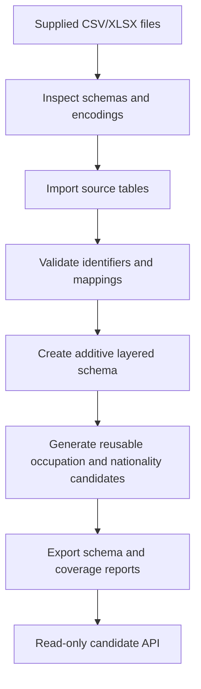

# Finaira Layered Generalization

## Idea

Finaira does not choose a single generalized replacement inside the database. Instead, it resolves an entity and exposes every valid representation from most specific to broadest.

The database supplies facts and structure. A separate policy component may later decide which level is authorized for a particular task.

```text
detected value
    |
    v
approved resolver
    |
    v
canonical entity
    |
    v
all valid candidates, ordered from exact to suppressed
    |
    v
future policy / JEV consumer
```

The database never performs privacy or utility scoring, never calls an LLM, and never selects a preferred candidate.

## Implementation shape

The implementation is additive to the existing Finaira database.

### Source tables

These tables preserve imported reference data:

- `occupations` and `occupation_aliases` store ESCO records.
- `isco_groups` stores the imported ISCO hierarchy.
- `nationality_aliases` stores the legacy nationality import.
- `nationality_aliases_v2`, `nationality_countries`, `nationality_geo_joins`, and `natural_earth_countries` store the active Wikidata-QID to Natural Earth lineage. `countries` and `m49_regions` remain historical compatibility tables only.
- `age_bands` and `date_rules` store configurable deterministic rules.
- `data_sources` stores checksums and provenance.

### Layer tables

These tables describe and materialize the generalization system:

- `generalization_schemes` defines one scheme per entity/taxonomy combination.
- `generalization_levels` defines ordered levels such as `EXACT`, `SUBREGION`, `CONTINENT`, or `SUPPRESSED`.
- `generalization_candidates` stores reusable occupation and nationality candidates.
- `candidate_metadata` stores descriptive properties such as rank, interval, category depth, and local-only status.
- `candidate_provenance` records source and derivation information.
- typed reference tables enforce ESCO-to-ISCO, nationality-to-country, and candidate-to-entity links.

AGE and DATE candidates are generated at request time because their exact values are unbounded. Their schemes and approved levels are still stored in the database.

## Build and migration flow



The migration sequence is:

```powershell
py -m finaira_generalization.cli migrate-layered
py -m finaira_generalization.cli generate-levels
py -m finaira_generalization.cli validate-levels
py -m finaira_generalization.cli candidate-coverage
```

`migrate-layered` creates a timestamped SQLite backup before adding the new tables. Existing source records are not replaced by the layered migration.

## Retrieval flow

The public read-only interface is:

```python
from finaira_generalization import GeneralizationDB

db = GeneralizationDB("data/processed/finaira_generalization.db")
result = db.get_candidates(
    entity_type="OCCUPATION",
    value="technical director",
    output_language="en",
)
```

The result contains:

- `resolution_status`
- `canonical_id`
- ordered `candidates`
- representation text, if a translation exists
- specificity rank and level code
- provenance and verification status
- factual metadata

The API does not return a selected or recommended level.

## Example 1: English occupation

Input:

```text
technical director
```

Flow:

```text
English alias
  -> occupation_aliases
  -> ESCO occupation URI
  -> ISCO code 2654
  -> ISCO 265
  -> ISCO 26
  -> ISCO 2
  -> suppression
```

Available candidates from the imported records:

| Rank | Level | Representation |
|---:|---|---|
| 0 | `EXACT` | technical director |
| 1 | `ISCO_UNIT` | Film, Stage and Related Directors and Producers |
| 2 | `ISCO_MINOR` | Creative and Performing Artists |
| 3 | `ISCO_SUB_MAJOR` | Legal, Social and Cultural Professionals |
| 4 | `ISCO_MAJOR` | Professionals |
| 5 | `SUPPRESSED` | Occupation information unspecified |

The ISCO labels come from ISCO. They are not copied from the ESCO occupation label.

## Example 2: Arabic occupation

Input:

```text
مطور برمجيات
```

Flow:

```text
Arabic spelling
  -> conservative Arabic normalization
  -> reviewed occupation alias
  -> ESCO URI
  -> associated ISCO unit group
  -> actual ISCO parent chain
  -> bilingual candidates where labels exist
```

If the Arabic alias is not unique, the result is `AMBIGUOUS`. The API does not choose one occupation based on fuzzy similarity.

## Example 3: Nationality with Natural Earth data

Input:

```text
مصرية
```

Flow:

```text
Arabic demonym
  -> nationality_aliases_v2
  -> Wikidata QID Q79
  -> nationality_geo_joins (MATCHED_QID)
  -> Natural Earth SUBREGION Northern Africa
  -> Natural Earth CONTINENT Africa
  -> suppression
```

Available candidates:

| Rank | Level | Code | Representation |
|---:|---|---|---|
| 0 | `EXACT` | EG | verified nationality alias |
| 1 | `SUBREGION` | Northern Africa | available in English |
| 2 | `CONTINENT` | Africa | available in English |
| 3 | `SUPPRESSED` | — | الجنسية غير محددة |

The representation describes nationality in a geographic category. It does not imply residence, birthplace, ethnicity, or eligibility for citizenship.

## Example 4: English nationality with missing translation

Input:

```text
Egyptian
```

The English demonym resolves to Q79, and the active source is Natural Earth v5.1.1. The extracted required Natural Earth fields contain no verified Arabic subregion/continent labels, so Arabic geographic representations are unavailable rather than fabricated:

```json
{
  "resolution_status": "MATCHED",
  "canonical_id": "Q79",
  "level_code": "SUBREGION",
  "representation": null,
  "available": false,
  "missing_reason": "MISSING_TRANSLATION"
}
```

No English geography label is fabricated.

## Example 5: Age 27

Input:

```text
27
```

Flow:

```text
numeric parser
  -> validate 0..120
  -> exact candidate
  -> matching narrow interval
  -> matching nested wide interval
  -> broad category
  -> suppression
```

Candidates:

| Rank | Level | Representation | Interval |
|---:|---|---|---|
| 0 | `EXACT` | 27 years | 27..27 |
| 1 | `NARROW_BAND` | 25–29 years | 25..29 |
| 2 | `WIDE_BAND` | 25–34 years | 25..34 |
| 3 | `BROAD_CATEGORY` | Adult | configured category |
| 4 | `SUPPRESSED` | Age unspecified | — |

The database validates containment between interval levels. It does not connect overlapping, non-nested bands as parent and child.

Arabic-Indic input such as `٢٧ سنة` follows the same path.

## Example 6: Date 2026-03-14

Input:

```text
2026-03-14
```

Flow:

```text
Gregorian parser
  -> exact date interval
  -> March 2026 interval
  -> Q1 2026 interval
  -> 2026 interval
  -> suppression
```

Candidates:

| Rank | Level | Representation | Interval |
|---:|---|---|---|
| 0 | `EXACT` | 14 March 2026 | 2026-03-14..2026-03-14 |
| 1 | `MONTH` | March 2026 | 2026-03-01..2026-03-31 |
| 2 | `QUARTER` | Q1 2026 | 2026-01-01..2026-03-31 |
| 3 | `YEAR` | 2026 | 2026-01-01..2026-12-31 |
| 4 | `SUPPRESSED` | Date unspecified | — |

Dates are generated dynamically. The database does not contain one row for every possible calendar date.

## Example 7: Unknown or ambiguous values

### Unknown occupation

```text
value: "not a real occupation"
status: NOT_FOUND
candidates: [SUPPRESSED]
```

The original value is never returned as a generalized representation.

### Conflicting alias

If an alias maps to more than one approved canonical entity:

```text
status: AMBIGUOUS
reason_code: ALIAS_COLLISION
```

The API returns no arbitrary occupation or country.

### Invalid age

```text
value: -4
status: INVALID_INPUT
```

### Ambiguous date

```text
value: 03/04/2026
status: AMBIGUOUS_DATE
```

A numeric date is accepted only when an explicit date format is supplied.

## Provenance and safety properties

Every reusable candidate has:

- a deterministic stable ID
- a scheme and level
- a specificity rank
- a review or verification status
- a derivation method
- source provenance where applicable
- descriptive metadata

Exact candidates are marked `is_local_only`. Suppression candidates are marked `is_suppression`. Neither flag authorizes disclosure; authorization remains outside this module.

## Current implementation commands

```powershell
# Inspect the actual schema
py -m finaira_generalization.cli show-schema

# Validate parent links and level ordering
py -m finaira_generalization.cli validate-levels

# Query all candidates
py -m finaira_generalization.cli candidates `
  --type NATIONALITY `
  --value "مصرية" `
  --language ar

# Run the complete test suite
py -m pytest -q
```

Generated schema and coverage documentation is stored under `reports/`.
