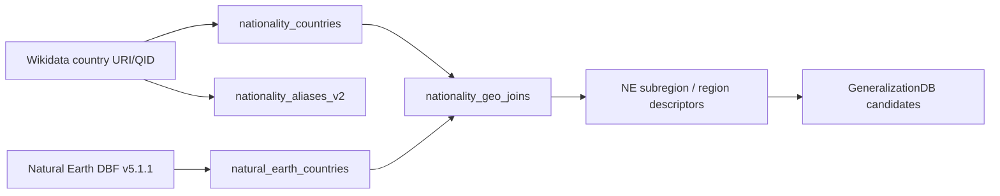
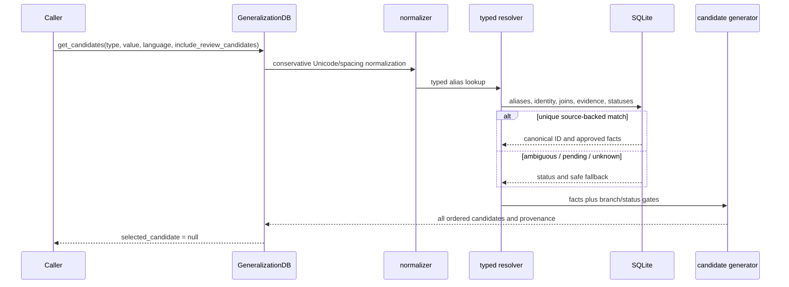

# Finaira generalization database

Status: implemented and exercised locally on 2026-11-14. This layer is an offline, deterministic Arabic/English reference database. It returns all valid candidates and never selects one. The current NER-v1 coverage audit is in [reports/ner_v1_generalization](../reports/ner_v1_generalization); its `alias_review_queue.csv` is a review queue only and never promotes corpus text automatically. Historical integration notes and before/after comparisons are in [reports/generalization_coverage_improvement](../reports/generalization_coverage_improvement). NATIONALITY-specific review is documented in [reports/nationality_improvement](../reports/nationality_improvement).

## Repository layout

```text
C:\Users\domma\poc_4\
├── config/                         # existing age/date and dataset configuration
├── data/processed/finaira_generalization.db
├── data/processed/finaira_generalization_backup_*.db
├── data/sources/natural_earth/
│   ├── ne_10m_admin_0_countries_v5.1.1.zip
│   └── ne_10m_admin_0_countries_v5.1.1.csv
├── finaira/                        # existing privacy pipeline; unchanged in scope
├── finaira_generalization/
│   ├── age_date.py
│   ├── build.py                     # existing ESCO/ISCO and legacy import
│   ├── candidates.py                # shared read-only API
│   ├── cli.py
│   ├── db.py                        # SQLAlchemy models and FK enforcement
│   ├── handoff.py                   # idempotent handoff importer
│   ├── layers.py                    # existing ESCO/ISCO/M49 layers + NE scheme
│   ├── natural_earth.py              # DBF-to-CSV extraction
│   └── schema_tools.py
├── reports/
│   ├── database_schema.sql           # exact SQLite DDL export
│   ├── database_erd.mmd              # generated ER diagram
│   ├── nationality_natural_earth_join_audit.csv
│   ├── handoff_import_report.json
│   ├── schema_before.md / schema_after.md
│   └── candidate_coverage.md
└── tests/
    ├── test_pipeline.py              # existing 10 tests
    ├── test_layered.py               # existing layered tests updated for NE behavior
    └── test_handoff.py                # integration, gating, integrity, idempotence
```

The handoff remains at `C:\Users\domma\Downloads\Finaira_Generalization_DB_Codex_Handoff_2026-11-12_ext`. ESCO/ISCO source files are existing external Downloads inputs configured in `config/datasets.yaml`; they were reused, not fabricated.

## Actual database schema

The authoritative generated schema is [reports/database_schema.sql](../reports/database_schema.sql), and the inspected column/PK/FK/index inventory is [reports/schema_after.md](../reports/schema_after.md). SQLite currently contains 56 tables, with foreign keys enabled by the SQLAlchemy connection hook in `finaira_generalization/db.py`.

### Legacy/reference tables retained for compatibility

`data_sources(source_id PK, name UNIQUE, version, source_url, retrieved_at, license, checksum)`; `occupations(occupation_id PK, label_ar, label_en, isco_code, source_id FK, review_status)`; `occupation_aliases(alias_id PK, occupation_id FK, alias_text, normalized_alias, language, source_id FK, review_status)`; `isco_groups(isco_code PK, parent_code, level, label_ar, label_en, arabic_label_status)`; `nationality_aliases(alias_id PK, alias_text, normalized_alias, language, country_iso2, source_id FK, review_status)`; `countries(iso2 PK, legacy country/M49 labels and codes)`; `m49_regions(code PK, parent_code FK, level, labels)`; `country_m49_links(iso2 PK/FK, subregion_code FK, region_code FK)`; `age_bands`, `date_rules`, and their scheme bridge tables; `generalization_schemes`, `generalization_levels`, `generalization_candidates`, `candidate_metadata`, `candidate_provenance`, and typed occupation/nationality bridge tables; `build_metadata`.

The legacy M49 tables are historical compatibility data only. Active NATIONALITY retrieval uses `nationality_aliases_v2` → `nationality_geo_joins` → `natural_earth_countries`.

### Added handoff tables

| Table | Primary key | Important foreign keys / indexes | Rows |
|---|---|---|---:|
| `import_batches` | `batch_id` | import status audit | 1 |
| `natural_earth_countries` | `natural_earth_id` | `source_id`; indexes on `wikidata_qid`, `iso_a2` | 258 |
| `natural_earth_country_aliases` | `alias_id` | `natural_earth_id`, `source_id`; normalized alias/language indexes | 2,204 |
| `nationality_countries` | `country_qid` | `source_id`; index on `iso2` | 239 |
| `nationality_aliases_v2` | `alias_key` | `country_qid`, `source_id`; indexes on normalized alias/language | 916 (857 source-verified + 59 reviewed) |
| `nationality_alias_review_provenance` | `provenance_id` | `alias_key`, `source_id`; unique alias/base/rule provenance | 67 |
| `nationality_geo_joins` | `country_qid` | `country_qid`, `natural_earth_id`, `source_id`; status indexes | 239 |
| `banks` | `bank_id` | `source_id`; finance-model index | 302 |
| `bank_aliases` | `alias_id` | `bank_id`, `source_id`; normalized alias/language indexes | 1,569 |
| `bank_evidence` | `evidence_id` | `bank_id`, `source_id` | 24 |
| `bank_candidates` | `candidate_id` | `bank_id`, `source_id`; unique `(bank_id, level_code)` | 1,510 |
| `bank_identity_model_records` | `record_id` | `canonical_bank_id`, `source_id`; family/model/review indexes | 303 |
| `bank_model_aliases` | `alias_id` | source record, canonical bank, normalized alias, enabled indexes | 1,524 |
| `bank_generalization_cohorts` | `safe_generalization_key` | source ID; model/eligibility indexes | 227 (198 supplied + 29 derived review-only) |
| `bank_generalization_forms` | `form_id` | source record, bank, cohort, level/model/enabled indexes | 606 (303 shared finance-model + 303 model-safe) |
| `bank_model_relationship_evidence` | `relationship_id` | two source-record FKs, source ID | 21 |
| `bank_model_do_not_merge` | `exclusion_id` | two source-record FKs, collision index | 12 |
| `bank_model_research_corrections` | `correction_id` | source-record FK, evidence index | 30 |
| `bank_model_evidence_notes` | `note_id` | source-record FK, risk index | 14 |
| `organizations` | `organization_qid` | `source_id`; status/kind indexes | 312 |
| `organization_aliases` | `alias_id` | `organization_qid`, `source_id`; normalized alias/language indexes | 566 |
| `industry_categories` | `category_code` | self-FK `parent_code`, `source_id` | 64 (63 source + virtual root) |
| `industry_qid_mappings` | `mapping_id` | `source_id`; QID/status/sector indexes | 73 |
| `organization_industries` | `link_id` | organization and mapping FKs, `source_id`; bridge indexes | 360 |
| `organization_exclusions` | `exclusion_id` | source ID; QID index | 6 |
| `organization_review_queue` | `review_id` | source ID; QID index | 42 |
| `government_entities` | `entity_id` | `source_id`; identity/country indexes | 12 |
| `government_aliases` | `alias_id` | `entity_id`, `source_id`; normalized alias/language indexes | 24 |
| `government_categories` | `category_code` | self-FK `parent_category_code`, `source_id` | 17 |
| `government_candidate_reviews` | `candidate_id` | `entity_id`, `source_id`; dimension index | 63 |
| `government_entity_categories` | `link_id` | entity/category/source FKs; bridge indexes | 24 |
| `government_review_queue` | `review_id` | `entity_id`, `source_id` | 12 |

All source-backed candidate records have source ID, source checksum through `data_sources`, verification/review state, and exact/local-only/suppression flags. Exact candidates are local-only; suppression candidates do not expose an input value. Legacy bank candidates keep `disclosure_approved=false`; an eligible model-safe cohort candidate sets it true only when the supplied model/relationship/review gates pass.

### ER diagram of the implemented relationships

```mermaid
erDiagram
  DATA_SOURCES ||--o{ NATURAL_EARTH_COUNTRIES : sources
  DATA_SOURCES ||--o{ NATIONALITY_COUNTRIES : sources
  DATA_SOURCES ||--o{ NATIONALITY_ALIASES_V2 : sources
  DATA_SOURCES ||--o{ NATIONALITY_ALIAS_REVIEW_PROVENANCE : sources
  DATA_SOURCES ||--o{ NATIONALITY_GEO_JOINS : sources
  NATIONALITY_COUNTRIES ||--o{ NATIONALITY_ALIASES_V2 : identifies
  NATIONALITY_ALIASES_V2 ||--o{ NATIONALITY_ALIAS_REVIEW_PROVENANCE : explains
  NATIONALITY_COUNTRIES ||--|| NATIONALITY_GEO_JOINS : audits
  NATURAL_EARTH_COUNTRIES ||--o{ NATIONALITY_GEO_JOINS : joins
  NATURAL_EARTH_COUNTRIES ||--o{ NATURAL_EARTH_COUNTRY_ALIASES : has
  DATA_SOURCES ||--o{ BANKS : sources
  BANKS ||--o{ BANK_ALIASES : has
  BANKS ||--o{ BANK_EVIDENCE : supported_by
  BANKS ||--o{ BANK_CANDIDATES : materializes
  DATA_SOURCES ||--o{ BANK_IDENTITY_MODEL_RECORDS : sources
  BANKS ||--o{ BANK_IDENTITY_MODEL_RECORDS : country_operation
  BANK_IDENTITY_MODEL_RECORDS ||--o{ BANK_MODEL_ALIASES : has
  BANKS ||--o{ BANK_MODEL_ALIASES : resolves_to
  DATA_SOURCES ||--o{ BANK_MODEL_ALIASES : sources
  DATA_SOURCES ||--o{ BANK_GENERALIZATION_COHORTS : sources
  BANK_GENERALIZATION_COHORTS ||--o{ BANK_GENERALIZATION_FORMS : contains
  BANK_IDENTITY_MODEL_RECORDS ||--o{ BANK_GENERALIZATION_FORMS : source_operation
  BANKS ||--o{ BANK_GENERALIZATION_FORMS : bank
  BANK_IDENTITY_MODEL_RECORDS ||--o{ BANK_MODEL_RELATIONSHIP_EVIDENCE : from_record
  BANK_IDENTITY_MODEL_RECORDS ||--o{ BANK_MODEL_RELATIONSHIP_EVIDENCE : to_record
  BANK_IDENTITY_MODEL_RECORDS ||--o{ BANK_MODEL_DO_NOT_MERGE : excluded_a
  BANK_IDENTITY_MODEL_RECORDS ||--o{ BANK_MODEL_DO_NOT_MERGE : excluded_b
  BANK_IDENTITY_MODEL_RECORDS ||--o{ BANK_MODEL_RESEARCH_CORRECTIONS : corrected
  BANK_IDENTITY_MODEL_RECORDS ||--o{ BANK_MODEL_EVIDENCE_NOTES : evidence
  DATA_SOURCES ||--o{ ORGANIZATIONS : sources
  ORGANIZATIONS ||--o{ ORGANIZATION_ALIASES : has
  ORGANIZATIONS ||--o{ ORGANIZATION_INDUSTRIES : has
  INDUSTRY_QID_MAPPINGS ||--o{ ORGANIZATION_INDUSTRIES : supplies
  INDUSTRY_CATEGORIES ||--o{ INDUSTRY_CATEGORIES : parent_of
  ORGANIZATIONS ||--o{ ORGANIZATION_REVIEW_QUEUE : reviewed_in
  ORGANIZATIONS ||--o{ ORGANIZATION_EXCLUSIONS : excluded_by
  DATA_SOURCES ||--o{ GOVERNMENT_ENTITIES : sources
  GOVERNMENT_ENTITIES ||--o{ GOVERNMENT_ALIASES : has
  GOVERNMENT_ENTITIES ||--o{ GOVERNMENT_CANDIDATE_REVIEWS : catalogs
  GOVERNMENT_CATEGORIES ||--o{ GOVERNMENT_CATEGORIES : parent_of
  GOVERNMENT_ENTITIES ||--o{ GOVERNMENT_ENTITY_CATEGORIES : classified_as
  GOVERNMENT_CATEGORIES ||--o{ GOVERNMENT_ENTITY_CATEGORIES : includes
```



## Source-to-table mapping and import flow

| Source | Destination | Authority/status handling |
|---|---|---|
| Supplied handoff aliases plus `data/sources/wikidata/wikidata_nationality_aliases_ar_en_v2.csv` | `nationality_countries`, `nationality_aliases_v2` | 857 source-verified Arabic/English Wikidata `P1549` aliases, QIDs extracted from URI, CC0 provenance |
| `reports/nationality_improvement/nationality_variant_review_queue.csv` | `nationality_aliases_v2`, `nationality_alias_review_provenance` | 59 reviewed aliases from 67 approved derivation rows; pending/rejected rows remain disabled |
| Official Natural Earth Admin-0 1:10m v5.1.1 ZIP | `natural_earth_countries` and derived CSV | 258 DBF rows; fields verified before conversion; public-domain terms |
| Wikidata labels/aliases API export | `natural_earth_country_aliases` | 2,174 deduplicated Arabic/English aliases linked by Wikidata QID; source-verified and enabled for COUNTRY only |
| Approved nationality variant review queue | `nationality_aliases_v2` | Only rows marked `APPROVED` with non-empty evidence are imported as `REVIEWED`; pending rows remain outside runtime |
| QID index CSV | source checksum/audit input | consistency audit only; never treated as Natural Earth |
| `banks_FINAL_evidence.csv` | `banks`, regenerated `bank_candidates` | authoritative 37-row master; blank Arabic names remain null |
| bank evidence CSV | `bank_evidence` | 24 evidence rows and 13 bank IDs |
| bank aliases CSV | `bank_aliases` | old review source retained; only source-supported aliases enabled |
| organization directory | `organizations`, aliases, industry bridge | all 312 use canonical `CORPORATION`; original UNIVERSITY/CORPORATION source kind is retained in `review_flags`; identities remain pending validation |
| taxonomy/mapping CSVs | `industry_categories`, `industry_qid_mappings` | 63 bilingual source categories + virtual root; mapping review state retained |
| organization review/exclusion CSVs | review/exclusion tables | no source row is promoted to verified |
| government seed/aliases/categories/catalog/review queue | government tables | all 12 identity rows remain review-only; narrow branches gated |
| existing ESCO/ISCO sources | legacy occupation tables and schemes | reused unchanged; no taxonomy fabricated |
| model-safe identity CSV | `bank_identity_model_records` | 303 source operations preserved; `BH-241` maps to existing `BH-197` as a duplicate source row |
| model-safe alias CSV | `bank_model_aliases` | all 1,524 aliases preserved; 525 enabled, 999 review/historical/blocked |
| model-safe cohort CSV | `bank_generalization_cohorts` | 198 supplied keys plus 29 derived review-only keys; 46 usable keys, with 152 supplied keys kept separate or review-gated |
| generated generalization forms | `bank_generalization_forms` | 303 source operations linked to a shared finance-model form and a model-safe cohort form (606 rows total) |
| relationship CSV | `bank_model_relationship_evidence` | 21 source relationships retained; relationship text does not override model/review gates |
| do-not-merge CSV | `bank_model_do_not_merge` | 12 explicit exclusions enforced during alias/cohort resolution |
| correction/evidence CSVs | `bank_model_research_corrections`, `bank_model_evidence_notes` | 30 corrections and 14 model-risk notes retained as provenance |

`py -m finaira_generalization.cli import-handoff` performs a timestamped copy of the existing DB, creates additive tables, imports in one transaction, regenerates bank candidates, writes `reports/handoff_import_report.*`, and writes the full Natural Earth audit. A repeat import updates stable keys and leaves row counts unchanged. Failure rolls back the transaction.

The runtime accepts `CORPORATION`, `ORGANIZATION`, and `UNIVERSITY` as compatible input labels and canonicalizes all three to `CORPORATION`. Organization-like exact candidates retain `source_semantic_kind` and source review flags in provenance. Industry candidates remain review-gated because the 312 identities are not production-verified.

`reports/bank_inventory.csv` is a database export containing one row per bank alias, including the bank classification, evidence status, language, alias kind, review status, and enabled-for-lookup flag.

The model-safe package is imported with `py scripts/import_bank_identity_model.py`; use `--dry-run` for validation and `--no-backup` only for disposable test databases. The actual migration report is [reports/bank_identity_model/migration_report.md](../reports/bank_identity_model/migration_report.md). The import reused 302 existing bank rows, mapped one duplicate source operation (`BH-241` → `BH-197`), preserved all 303 source records, enabled 525 aliases, and made 46 model-safe keys available. Of those, 33 approved cohort keys share a generalization across 109 operations; the remaining 152 keys remain review, historical, blocked, or unique/separate. `EG_BANK_001` and `EG_BANK_024` retain `review_required=YES`; their mixed classifications are not promoted to automatic shared grouping.

## Nationality lineage and join results



The runtime tries `WIKIDATAID` first. ISO A2 is used only when the QID is absent and exactly one Natural Earth row is available. Current audit: 233 QIDs; 223 `MATCHED_QID`, 2 `MATCHED_ISO`, 1 `MISMATCH` (Taiwan ISO representation), and 7 unresolved edge cases. No unresolved row receives a guessed region. See [reports/nationality_natural_earth_join_audit.csv](../reports/nationality_natural_earth_join_audit.csv).

`COUNTRY` is a separate runtime path. It resolves verified Wikidata labels/aliases linked to Natural Earth by QID first, then Natural Earth `name_ar`, `name_en`, or validated `ISO_A2`, and returns Natural Earth exact, subregion, UN region, continent, and suppression candidates. Reviewed corpus variants are marked `REVIEWED` in exact-candidate provenance. Historical identities, ambiguous names, cities/regions, and malformed values remain suppressed. It never treats a country name as a nationality alias. Arabic regional labels remain unavailable unless Natural Earth supplies a verified Arabic field.

Examples:

- `NATIONALITY`, English `Egyptian`: exact `Egyptian` (local-only), `Northern Africa`, `Africa`, suppression; provenance includes Q79, Natural Earth ID, checksum, and `MATCHED_QID`.
- `COUNTRY`, English `Egypt`: exact `Egypt` (local-only), Natural Earth subregion/region/continent descriptors, suppression.
- `NATIONALITY`, Arabic `مصرية`: exact Arabic source alias; Natural Earth has no verified Arabic subregion/region descriptor in the extracted required fields, so those two labels are explicitly unavailable rather than invented.

## Runtime lookup sequence



Bank model-aware lookup now exposes `EXACT → FINANCE_MODEL → MODEL_SAFE_GROUP → BANKING_INSTITUTION → FINANCIAL_INSTITUTION → SUPPRESSED`. `FINANCE_MODEL` is the shared human-facing form: different banks with the same verified model converge on the same candidate ID and bilingual label, such as `Conventional bank`, `Bank offering conventional and Islamic banking services`, or `Islamic bank`. `MODEL_SAFE_GROUP` remains the more specific supplied cohort form and retains the source safe key in provenance. Finance-model forms are persisted in `bank_generalization_forms` and are enabled only for active source operations whose model record is not review-required; pending, historical, unknown, non-bank, and conflicting rows remain review-only. A model-safe key is shared only when the source cohort permits it and all member records pass relationship, model, active-bank, and review gates. Organization-specific industry candidates are absent by default until both identity and company-to-industry links are approved; `include_review_candidates=True` exposes them only as `REVIEW_ONLY`. Government function/form branches are separate and hidden by default.

## Bilingual examples for every supported type

| Type | English | Arabic / behavior |
|---|---|---|
| `NATIONALITY` | `Egyptian` → Natural Earth descriptors | `مصرية` → Arabic exact alias; unavailable region translations are explicit |
| `BANK` | `Banque Misr` → mixed finance model and broad institution levels | Arabic bank exact name is unavailable because all 37 master Arabic fields are blank; bilingual finance labels remain source-provided |
| `CORPORATION` / `ORGANIZATION` / `UNIVERSITY` | `Edita Food Industries S.A.E.` or `New Cairo Technological University` → canonical CORPORATION pending exact/company/suppression only | `شركة` is the safe generic fallback; source university kind is provenance only and no unapproved industry claim is exposed |
| `GOVERNMENT_ENTITY` | unknown → Government entity/suppression | `وزارة المالية` → review-only exact + generic government entity + suppression; narrow function/form branches require review flag |
| `OCCUPATION` / `JOB_TITLE` | `technical director` → canonical `JOB_TITLE`, ESCO exact and ISCO chain; `senior technical director` → longest phrase `technical director` | both accepted labels share the ESCO/ISCO resolver; Arabic ESCO aliases and labels are reused |
| `AGE` | `27` → exact, 25–29, 25–34, Adult, suppression | `٢٧` follows the same deterministic intervals |
| `DATE` | `2026-03-14` → exact, March, Q1, year, suppression | Arabic labels use `14 مارس 2026`; `03/04/2026` is rejected unless a format is supplied |

### Job-title and occupation compatibility behavior

`OCCUPATION` is a compatibility input label only. The shared candidate API and the legacy `Generalizer` normalize it to `JOB_TITLE`, and both labels use `JOB_TITLE_ISCO08` backed by the existing ESCO aliases and ISCO-08 groups.

Resolution is deterministic: try the complete normalized alias, each slash-separated alias variant, the complete punctuation-normalized phrase, then contiguous phrases from longest to shortest. A slash-separated variant such as `مدير الموارد البشرية / مديرة الموارد البشرية` is indexed as two independently queryable variants. A shortened match is marked `LONGEST_PHRASE_MATCH` and records the matched phrase in candidate provenance; it is not reported as an exact match to the original value. Alias collisions remain `AMBIGUOUS`.

An unresolved value returns `JOB_TITLE_1`, `JOB_TITLE_2`, and `SUPPRESSED`, with reason `UNRECOGNIZED_JOB_TITLE_GENERIC_FALLBACK`. These are safe generic configured fallbacks, not unique pseudonyms, a vault, or a claim that the input was recognized. After slash-variant indexing, the 2026-11-14 audit merged both source labels: 2,442 unique values and 9,916 spans; 268 values / 2,259 spans resolved through ESCO/ISCO, 8 values / 9 spans remain ambiguous, and 2,166 values / 7,648 spans use the generic fallback.

### Independent benchmark

The separate benchmark is generated by `scripts/benchmark_job_occupation_coverage.py` and written to `reports/job_occupation_benchmark/`. It does not reuse NER spans and does not import external titles into the production database. The available O*NET 31.0 benchmark contains 44,779 unique alternate job titles and 7,041 unique reported titles. Exact/normalized coverage is only 8.63% and 17.81%; longest-phrase candidates add 35.15 and 32.95 percentage points, respectively, but are not exact recognition. O*NET is English-only. BLS SOC Direct Match, CAPMAS Egyptian Arabic, Egypt Occupational Outlook, and ASCO Arabic inputs are supported by the script and remain explicitly marked unavailable until their source files are supplied; no substitute data is silently used.

The complete production JOB_TITLE inventory is exported in [reports/job_title_database](../reports/job_title_database): `job_title_taxonomy.csv` contains all 3,018 canonical ESCO occupations, while `job_title_aliases.csv` contains all 36,992 enabled Arabic/English lookup aliases with ISCO codes, review status, and source provenance. Language-specific files are available for English and Arabic inspection.

## SQL inspection examples

```sql
PRAGMA foreign_keys;
PRAGMA integrity_check;
PRAGMA foreign_key_check;

SELECT nc.country_qid, nc.iso2, ng.join_status, ne.name_en, ne.subregion, ne.region_un
FROM nationality_countries nc
JOIN nationality_geo_joins ng ON ng.country_qid = nc.country_qid
LEFT JOIN natural_earth_countries ne ON ne.natural_earth_id = ng.natural_earth_id
WHERE nc.country_qid = 'Q79';

SELECT b.bank_id, b.finance_model, bc.level_code, bc.label_en,
       bc.is_local_only, bc.is_suppression, bc.disclosure_approved
FROM banks b JOIN bank_candidates bc ON bc.bank_id = b.bank_id
WHERE b.bank_id = 'EG_BANK_001'
ORDER BY bc.specificity_rank;

SELECT o.organization_qid, o.import_decision, oi.industry_qid,
       oi.subcategory_code, oi.verification_status, m.review_status
FROM organizations o
JOIN organization_industries oi ON oi.organization_qid = o.organization_qid
LEFT JOIN industry_qid_mappings m ON m.mapping_id = oi.mapping_id
WHERE o.organization_qid = 'Q106301298';
```

## Executable Python examples

```python
from finaira_generalization import GeneralizationDB

db = GeneralizationDB("data/processed/finaira_generalization.db")
print(db.get_candidates("BANK", "Banque Misr", output_language="en"))
print(db.get_candidates("NATIONALITY", "مصرية", output_language="ar"))
print(db.get_candidates("GOVERNMENT_ENTITY", "وزارة المالية", output_language="ar"))
print(db.get_candidates("DATE", "03/04/2026", output_language="en",
                        context={"date_format": "%d/%m/%Y"}))
```

The return object contains `resolution_status`, `canonical_id`, all candidates, level code, labels, source, verification status, `is_exact`, `is_local_only`, `is_suppression`, and provenance. The API never returns a selected candidate.

## CLI and validation

```powershell
py -X utf8 -m finaira_generalization.cli import-handoff
py -X utf8 -m finaira_generalization.cli show-schema
py -X utf8 -m finaira_generalization.cli validate-levels
py -X utf8 -m finaira_generalization.cli candidate-coverage
py -X utf8 -m finaira_generalization.cli candidates --type NATIONALITY --value "Egyptian" --language en
py -X utf8 -m finaira_generalization.cli candidates --type COUNTRY --value "Egypt" --language en
py -X utf8 -m finaira_generalization.cli candidates --type BANK --value "Banque Misr" --language en
py -X utf8 scripts/run_generalization_ui.py --port 8765
py scripts/refresh_wikidata_nationalities.py
py scripts/export_ner_generalization_values.py --dataset C:\path\to\finaira_ner_v1\finaira_ner_v1
py scripts/audit_ner_generalization_coverage.py --dataset C:\path\to\finaira_ner_v1\finaira_ner_v1 --db data\processed\finaira_generalization.db
py -X utf8 -m pytest -q
```

The local explorer opens at `http://127.0.0.1:8765/`. It accepts Arabic or
English input, lets the user choose the entity type and returned-label
language, and displays the full candidate chain including exact, review-only,
fallback, and suppression candidates. It is a read-only database explorer;
it does not select a candidate or create pseudonyms.

When `DATE` is selected, the explorer exposes optional explicit-format,
numeric-order, calendar, value-hint, relative-anchor, and two-digit-year-base
controls. The response includes a Date detection details panel showing the
detector status, calendar, precision, format family, confidence, detected ISO
date when available, and the raw detector metadata. Leaving the controls
automatic preserves ambiguity instead of guessing.

## GCC bank classification integration

The GCC package is stored under
`data/sources/bank/gcc_2026/`. The audited CSV is the classification
authority; `gcc_banks_aliases_flat_2026.csv` is the alias authority. Supporting
JSON, XLSX, and PDF artifacts are registered in `data_sources` for checksum
and provenance tracking.

The additive tables are `bank_audit_classifications` and
`bank_relationships`. The first preserves every audited source row and its
raw model, scope, entity kind, operational status, licence evidence,
confidence, review action, and review note. The second stores only explicit
audited relationships such as `ISLAMIC_WINDOW_OF`. Existing `banks`,
`bank_aliases`, `bank_evidence`, and `bank_candidates` remain the runtime
tables. The GCC importer regenerates candidates only for GCC records, so the
existing Egyptian handoff refresh cannot erase them.

Run the importer with:

```powershell
py -X utf8 scripts/import_gcc_bank_audit.py --dry-run
py -X utf8 scripts/import_gcc_bank_audit.py --backup
```

The importer is transactional and idempotent. It preserves existing bank
rows and aliases, collapses only duplicate normalized aliases required by the
existing uniqueness constraint, reconciles BH-197/BH-241 as one BOK source
identity, and reports all collapses in
`reports/gcc_bank_audit/migration_report.json` and
`reports/gcc_bank_audit/audit_results.csv`.

Current integrated counts:

- 302 bank identities: 37 existing Egyptian records plus 265 GCC records
  after the one explicit BOK duplicate reconciliation.
- 1,569 bank aliases, including all 86 pre-existing Egyptian aliases and
  1,483 normalized GCC aliases; 2 source duplicates were collapsed.
- 266 audited classification rows, 5 Islamic-window parent relationships,
  and 1,510 bank candidates.
- Source model rows: 175 conventional, 43 Islamic, 5 Islamic windows, 4
  specialized/development, 16 unknown, 16 historical, and 7 not applicable.
- Conservative licence status: 94 confirmed, 29 provisional, 40 requiring
  current-year recheck, 75 unverified, 16 historical, 5 linked windows, and
  7 not applicable. Only the 94 confirmed rows are eligible for the confirmed
  licensed-bank count.
- Operational status: 94 active listed, 138 active but requiring review, 3
  licensed but not operational, 14 licence-unverified candidates, and 1
  requiring a 2026 recheck, with 16 historical rows.

Specific safeguards are tested: STC Bank remains `UNKNOWN`; Oman Islamic
windows link to Bank Muscat, National Bank of Oman, Bank Dhofar, Ahlibank
Oman, and Sohar International; Alizz remains a separate Islamic bank; Al
Baraka Group is not counted as a commercial bank; BOK duplicate aliases are
ambiguous rather than arbitrarily resolved; and Qatar caution rows remain
provisional.

The generated report is the authoritative list of records requiring review,
unverified licences, duplicate candidates, operational statuses, and source
actions. No classification is upgraded merely because an entity appears in a
directory.

For alias-family research, run
`py -X utf8 scripts/export_bank_alias_collision_queue.py`. It writes
`reports/gcc_bank_audit/bank_alias_collision_research_queue.csv`, containing
all 203 exact normalized alias collision groups with member IDs, countries,
banking models, entity kinds, licence statuses, and a research question.

## Counts, verification, and unresolved data

- Natural Earth: 258 rows, source version 5.1.1; 239 nationality QIDs retained; 230 QID matches, 2 guarded ISO matches, and 7 unresolved legacy edge cases. Country lookup uses all 258 Natural Earth rows. NER-v1 COUNTRY coverage is 174/229 unique values (75.98%) and 2,904/3,009 spans (96.51%) after 31 approved review rows, deduplicated to 30 runtime aliases. The remaining 55 values and 105 spans are suppressed in `reports/ner_v1_generalization/missing_country.csv` and `reports/ner_v1_generalization/country_review_queue.csv`.
- Nationality aliases: 857 source-verified Arabic and English `P1549` rows plus 59 reviewed Arabic variants across validated QIDs. The coverage export records 28 Natural Earth records with no verified Arabic/English demonym; no form is invented for them. The review provenance table preserves 67 derivation/evidence rows for 59 enabled aliases. COUNTRY has 2,174 source-verified Wikidata label/alias rows plus 30 reviewed current-country variants.
- Egyptian baseline banks: 37 total; 24 conventional, 9 mixed, 4 Islamic; 86 aliases (50 English, 36 Arabic), 50 enabled English aliases and 36 enabled Arabic aliases; 47 are enabled by explicit `APPROVED_BY_USER` review status. 24 evidence rows cover 13 bank IDs; 185 baseline candidates; 37/37 official Arabic master names remain blank. Conventional labels retain `EVIDENCE_BY_ABSENCE_NOT_CONVENTIONAL_ONLY_PROOF` limitations. See `reports/bank_inventory.csv`.
- Organizations: 312 QIDs; 191 source rows detected as corporations and 121 as universities, all stored under canonical `semantic_kind=CORPORATION`; 360 industry links; 73 concept mappings; 63 bilingual source categories; 48 missing Arabic organization names; all identities pending. No organization is production-verified by this import.
- Government: 12 seed entities, 24 aliases, 17 categories, 63 review-catalog rows; all 24 aliases are enabled with explicit `APPROVED_BY_USER` status, while all 12 identity rows remain `REVIEW_REQUIRED` and all specific mappings remain review-only.
- Existing reference layer: 3,018 occupations, 1,149 ISCO groups, 844 legacy nationality aliases, 7 age bands, 3 date rules.

Implemented and tested: additive schema, backup, FK enforcement, Natural Earth extraction/join audit, bank regeneration, review gating, generic fallbacks, bilingual output where source labels exist, deterministic age/date, idempotent handoff import, legacy ESCO/ISCO behavior, and integrity checks.

Provisional or unresolved: Natural Earth mismatches/unmatched territories, all bank Arabic exact names, pending organizations and government identities, and any review-only category. These are explicitly surfaced; no missing evidence is guessed.

## Rule-based date atlas detector

`finaira_generalization/date_detector.py` is the deterministic detector and
generalizer used by both `age_date.py` compatibility functions and the shared
`GeneralizationDB` DATE path. It preserves the raw value and reports
`VERIFIED`, `AMBIGUOUS`, `INVALID_INPUT`, `UNSUPPORTED`, or `NEEDS_CONTEXT`.

Implemented rule families include ISO calendar/week/ordinal/timestamp forms,
compact YYYYMMDD, explicit and unambiguous numeric DMY/MDY/YMD, space and
labeled numeric forms, English/Arabic/regional Gregorian month names,
Unicode digit scripts, partial dates, fiscal quarter/year, relative dates
with an anchor, epoch values with an explicit hint, and named Hijri/Solar
Hijri dates. Requested non-Gregorian calendars are retained as raw calendar
components; they are never converted without a supplied conversion method.

Full Gregorian dates expose `EXACT`, `MONTH`, `QUARTER`, `SEASON`,
`HALF_YEAR`, `YEAR`, `DECADE`, and `SUPPRESSED`. Each runtime candidate has
the source, configured verification status, exact/local-only/suppression
flags, detector provenance, calendar, precision, format family, confidence,
raw value, and closed interval bounds where a Gregorian interval is safe.
Ambiguous values such as `03/04/2026` require `date_format`, `date_order`, or
equivalent caller context; they are not silently guessed.

## Test record and exclusions

Before the current coverage-improvement changes: `py -m pytest -q` → **21 passed in 17.12s**.

After coverage changes: `py -X utf8 -m pytest -q` → **26 passed in 72.19s**.

After country and nationality adjudication: `py -3 -m pytest -q` → **28 passed in 25.22s**. The final suite includes current-country reviewed aliases, historical/city/ambiguous suppression, Natural Earth joins, source/QID/derivation adjudication, reviewed-alias gating, Arabic/English nationality lookup, corrected Palestine QID handling, duplicate provenance, malformed/pending cases, FK/integrity checks, and two consecutive idempotent imports.

After the rule-based date detector: `py -3 -m pytest -q` → **42 passed in 50.13s**. The added date tests cover multilingual and Unicode-digit parsing, ISO week/ordinal/timestamp forms, partial dates, explicit ambiguity handling, non-Gregorian preservation, relative-date context, invalid input, expanded candidate levels, provenance, and interval metadata.

After GCC bank classification integration: `py -3 -m pytest -q` → **46 passed in 41.33s**. The added tests cover audit provenance, conservative licence counts, Islamic windows and parent links, digital/unknown models, historical and non-bank records, duplicate reconciliation, alias preservation, safe ambiguity, foreign-key integrity, and repeated imports.

This layer does not implement JEV-U, JEV-P, privacy scoring, utility ranking, policy/disclosure selection, external LLM or cloud calls, or a new pseudonymization vault. The `finaira` privacy pipeline now treats `COUNTRY` as `GENERALIZE`, canonicalizes `ORGANIZATION` and `UNIVERSITY` to `CORPORATION`, selects the broadest verified database candidate, and falls back to a request-scoped pseudonym when no safe candidate is available.
