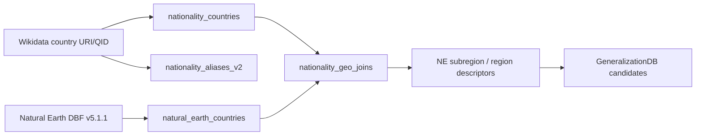
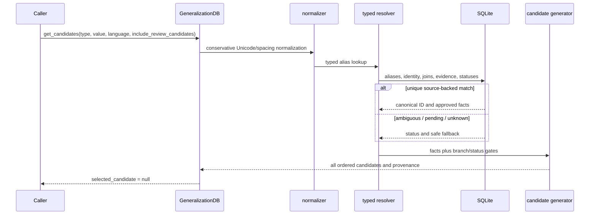

# Finaira generalization database

Status: implemented and exercised locally on 2026-11-13. This layer is an offline, deterministic Arabic/English reference database. It returns all valid candidates and never selects one. The current NER-v1 coverage audit is in [reports/generalization_coverage_improvement](../reports/generalization_coverage_improvement); its `alias_review_queue.csv` is a review queue only and never promotes corpus text automatically. NATIONALITY-specific review is documented in [reports/nationality_improvement](../reports/nationality_improvement).

## Repository layout

```text
C:\Users\domma\poc_4\
├── config/                         # existing age/date and dataset configuration
├── data/processed/finaira_generalization.db
├── data/processed/finaira_generalization_backup_*.db
├── data/sources/natural_earth/
│   ├── ne_10m_admin_0_countries_v5.1.1.zip
│   └── ne_10m_admin_0_countries_v5.1.1.csv
├── finaira/                        # existing privacy pipeline; unchanged in scope
├── finaira_generalization/
│   ├── age_date.py
│   ├── build.py                     # existing ESCO/ISCO and legacy import
│   ├── candidates.py                # shared read-only API
│   ├── cli.py
│   ├── db.py                        # SQLAlchemy models and FK enforcement
│   ├── handoff.py                   # idempotent handoff importer
│   ├── layers.py                    # existing ESCO/ISCO/M49 layers + NE scheme
│   ├── natural_earth.py              # DBF-to-CSV extraction
│   └── schema_tools.py
├── reports/
│   ├── database_schema.sql           # exact SQLite DDL export
│   ├── database_erd.mmd              # generated ER diagram
│   ├── nationality_natural_earth_join_audit.csv
│   ├── handoff_import_report.json
│   ├── schema_before.md / schema_after.md
│   └── candidate_coverage.md
└── tests/
    ├── test_pipeline.py              # existing 10 tests
    ├── test_layered.py               # existing layered tests updated for NE behavior
    └── test_handoff.py                # integration, gating, integrity, idempotence
```

The handoff remains at `C:\Users\domma\Downloads\Finaira_Generalization_DB_Codex_Handoff_2026-11-12_ext`. ESCO/ISCO source files are existing external Downloads inputs configured in `config/datasets.yaml`; they were reused, not fabricated.

## Actual database schema

The authoritative generated schema is [reports/database_schema.sql](../reports/database_schema.sql), and the inspected column/PK/FK/index inventory is [reports/schema_after.md](../reports/schema_after.md). SQLite currently contains 52 tables, with foreign keys enabled by the SQLAlchemy connection hook in `finaira_generalization/db.py`.

### Legacy/reference tables retained for compatibility

`data_sources(source_id PK, name UNIQUE, version, source_url, retrieved_at, license, checksum)`; `occupations(occupation_id PK, label_ar, label_en, isco_code, source_id FK, review_status)`; `occupation_aliases(alias_id PK, occupation_id FK, alias_text, normalized_alias, language, source_id FK, review_status)`; `isco_groups(isco_code PK, parent_code, level, label_ar, label_en, arabic_label_status)`; `nationality_aliases(alias_id PK, alias_text, normalized_alias, language, country_iso2, source_id FK, review_status)`; `countries(iso2 PK, legacy country/M49 labels and codes)`; `m49_regions(code PK, parent_code FK, level, labels)`; `country_m49_links(iso2 PK/FK, subregion_code FK, region_code FK)`; `age_bands`, `date_rules`, and their scheme bridge tables; `generalization_schemes`, `generalization_levels`, `generalization_candidates`, `candidate_metadata`, `candidate_provenance`, and typed occupation/nationality bridge tables; `build_metadata`.

The legacy M49 tables are historical compatibility data only. Active NATIONALITY retrieval uses `nationality_aliases_v2` → `nationality_geo_joins` → `natural_earth_countries`.

### Added handoff tables

| Table | Primary key | Important foreign keys / indexes | Rows |
|---|---|---|---:|
| `import_batches` | `batch_id` | import status audit | 1 |
| `natural_earth_countries` | `natural_earth_id` | `source_id`; indexes on `wikidata_qid`, `iso_a2` | 258 |
| `natural_earth_country_aliases` | `alias_id` | `natural_earth_id`, `source_id`; normalized alias/language indexes | 2,204 |
| `nationality_countries` | `country_qid` | `source_id`; index on `iso2` | 239 |
| `nationality_aliases_v2` | `alias_key` | `country_qid`, `source_id`; indexes on normalized alias/language | 916 (857 source-verified + 59 reviewed) |
| `nationality_alias_review_provenance` | `provenance_id` | `alias_key`, `source_id`; unique alias/base/rule provenance | 67 |
| `nationality_geo_joins` | `country_qid` | `country_qid`, `natural_earth_id`, `source_id`; status indexes | 239 |
| `banks` | `bank_id` | `source_id`; finance-model index | 37 |
| `bank_aliases` | `alias_id` | `bank_id`, `source_id`; normalized alias/language indexes | 86 |
| `bank_evidence` | `evidence_id` | `bank_id`, `source_id` | 24 |
| `bank_candidates` | `candidate_id` | `bank_id`, `source_id`; unique `(bank_id, level_code)` | 185 |
| `organizations` | `organization_qid` | `source_id`; status/kind indexes | 312 |
| `organization_aliases` | `alias_id` | `organization_qid`, `source_id`; normalized alias/language indexes | 566 |
| `industry_categories` | `category_code` | self-FK `parent_code`, `source_id` | 64 (63 source + virtual root) |
| `industry_qid_mappings` | `mapping_id` | `source_id`; QID/status/sector indexes | 73 |
| `organization_industries` | `link_id` | organization and mapping FKs, `source_id`; bridge indexes | 360 |
| `organization_exclusions` | `exclusion_id` | source ID; QID index | 6 |
| `organization_review_queue` | `review_id` | source ID; QID index | 42 |
| `government_entities` | `entity_id` | `source_id`; identity/country indexes | 12 |
| `government_aliases` | `alias_id` | `entity_id`, `source_id`; normalized alias/language indexes | 24 |
| `government_categories` | `category_code` | self-FK `parent_category_code`, `source_id` | 17 |
| `government_candidate_reviews` | `candidate_id` | `entity_id`, `source_id`; dimension index | 63 |
| `government_entity_categories` | `link_id` | entity/category/source FKs; bridge indexes | 24 |
| `government_review_queue` | `review_id` | `entity_id`, `source_id` | 12 |

All source-backed candidate records have source ID, source checksum through `data_sources`, verification/review state, and exact/local-only/suppression flags. Exact candidates are local-only; suppression candidates do not expose an input value. `disclosure_approved` is always false for bank candidates.

### ER diagram of the implemented relationships

```mermaid
erDiagram
  DATA_SOURCES ||--o{ NATURAL_EARTH_COUNTRIES : sources
  DATA_SOURCES ||--o{ NATIONALITY_COUNTRIES : sources
  DATA_SOURCES ||--o{ NATIONALITY_ALIASES_V2 : sources
  DATA_SOURCES ||--o{ NATIONALITY_ALIAS_REVIEW_PROVENANCE : sources
  DATA_SOURCES ||--o{ NATIONALITY_GEO_JOINS : sources
  NATIONALITY_COUNTRIES ||--o{ NATIONALITY_ALIASES_V2 : identifies
  NATIONALITY_ALIASES_V2 ||--o{ NATIONALITY_ALIAS_REVIEW_PROVENANCE : explains
  NATIONALITY_COUNTRIES ||--|| NATIONALITY_GEO_JOINS : audits
  NATURAL_EARTH_COUNTRIES ||--o{ NATIONALITY_GEO_JOINS : joins
  NATURAL_EARTH_COUNTRIES ||--o{ NATURAL_EARTH_COUNTRY_ALIASES : has
  DATA_SOURCES ||--o{ BANKS : sources
  BANKS ||--o{ BANK_ALIASES : has
  BANKS ||--o{ BANK_EVIDENCE : supported_by
  BANKS ||--o{ BANK_CANDIDATES : materializes
  DATA_SOURCES ||--o{ ORGANIZATIONS : sources
  ORGANIZATIONS ||--o{ ORGANIZATION_ALIASES : has
  ORGANIZATIONS ||--o{ ORGANIZATION_INDUSTRIES : has
  INDUSTRY_QID_MAPPINGS ||--o{ ORGANIZATION_INDUSTRIES : supplies
  INDUSTRY_CATEGORIES ||--o{ INDUSTRY_CATEGORIES : parent_of
  ORGANIZATIONS ||--o{ ORGANIZATION_REVIEW_QUEUE : reviewed_in
  ORGANIZATIONS ||--o{ ORGANIZATION_EXCLUSIONS : excluded_by
  DATA_SOURCES ||--o{ GOVERNMENT_ENTITIES : sources
  GOVERNMENT_ENTITIES ||--o{ GOVERNMENT_ALIASES : has
  GOVERNMENT_ENTITIES ||--o{ GOVERNMENT_CANDIDATE_REVIEWS : catalogs
  GOVERNMENT_CATEGORIES ||--o{ GOVERNMENT_CATEGORIES : parent_of
  GOVERNMENT_ENTITIES ||--o{ GOVERNMENT_ENTITY_CATEGORIES : classified_as
  GOVERNMENT_CATEGORIES ||--o{ GOVERNMENT_ENTITY_CATEGORIES : includes
```



## Source-to-table mapping and import flow

| Source | Destination | Authority/status handling |
|---|---|---|
| Supplied handoff aliases plus `data/sources/wikidata/wikidata_nationality_aliases_ar_en_v2.csv` | `nationality_countries`, `nationality_aliases_v2` | 857 source-verified Arabic/English Wikidata `P1549` aliases, QIDs extracted from URI, CC0 provenance |
| `reports/nationality_improvement/nationality_variant_review_queue.csv` | `nationality_aliases_v2`, `nationality_alias_review_provenance` | 59 reviewed aliases from 67 approved derivation rows; pending/rejected rows remain disabled |
| Official Natural Earth Admin-0 1:10m v5.1.1 ZIP | `natural_earth_countries` and derived CSV | 258 DBF rows; fields verified before conversion; public-domain terms |
| Wikidata labels/aliases API export | `natural_earth_country_aliases` | 2,174 deduplicated Arabic/English aliases linked by Wikidata QID; source-verified and enabled for COUNTRY only |
| Approved nationality variant review queue | `nationality_aliases_v2` | Only rows marked `APPROVED` with non-empty evidence are imported as `REVIEWED`; pending rows remain outside runtime |
| QID index CSV | source checksum/audit input | consistency audit only; never treated as Natural Earth |
| `banks_FINAL_evidence.csv` | `banks`, regenerated `bank_candidates` | authoritative 37-row master; blank Arabic names remain null |
| bank evidence CSV | `bank_evidence` | 24 evidence rows and 13 bank IDs |
| bank aliases CSV | `bank_aliases` | old review source retained; only source-supported aliases enabled |
| organization directory | `organizations`, aliases, industry bridge | all 312 remain pending identity validation |
| taxonomy/mapping CSVs | `industry_categories`, `industry_qid_mappings` | 63 bilingual source categories + virtual root; mapping review state retained |
| organization review/exclusion CSVs | review/exclusion tables | no source row is promoted to verified |
| government seed/aliases/categories/catalog/review queue | government tables | all 12 identity rows remain review-only; narrow branches gated |
| existing ESCO/ISCO sources | legacy occupation tables and schemes | reused unchanged; no taxonomy fabricated |

`py -m finaira_generalization.cli import-handoff` performs a timestamped copy of the existing DB, creates additive tables, imports in one transaction, regenerates bank candidates, writes `reports/handoff_import_report.*`, and writes the full Natural Earth audit. A repeat import updates stable keys and leaves row counts unchanged. Failure rolls back the transaction.

## Nationality lineage and join results



The runtime tries `WIKIDATAID` first. ISO A2 is used only when the QID is absent and exactly one Natural Earth row is available. Current audit: 233 QIDs; 223 `MATCHED_QID`, 2 `MATCHED_ISO`, 1 `MISMATCH` (Taiwan ISO representation), and 7 unresolved edge cases. No unresolved row receives a guessed region. See [reports/nationality_natural_earth_join_audit.csv](../reports/nationality_natural_earth_join_audit.csv).

`COUNTRY` is a separate runtime path. It resolves verified Wikidata labels/aliases linked to Natural Earth by QID first, then Natural Earth `name_ar`, `name_en`, or validated `ISO_A2`, and returns Natural Earth exact, subregion, UN region, continent, and suppression candidates. Reviewed corpus variants are marked `REVIEWED` in exact-candidate provenance. Historical identities, ambiguous names, cities/regions, and malformed values remain suppressed. It never treats a country name as a nationality alias. Arabic regional labels remain unavailable unless Natural Earth supplies a verified Arabic field.

Examples:

- `NATIONALITY`, English `Egyptian`: exact `Egyptian` (local-only), `Northern Africa`, `Africa`, suppression; provenance includes Q79, Natural Earth ID, checksum, and `MATCHED_QID`.
- `COUNTRY`, English `Egypt`: exact `Egypt` (local-only), Natural Earth subregion/region/continent descriptors, suppression.
- `NATIONALITY`, Arabic `مصرية`: exact Arabic source alias; Natural Earth has no verified Arabic subregion/region descriptor in the extracted required fields, so those two labels are explicitly unavailable rather than invented.

## Runtime lookup sequence



Bank candidates are regenerated from the final master: `EXACT → FINANCE_MODEL → BANKING_INSTITUTION → FINANCIAL_INSTITUTION → SUPPRESSED`. Organization-specific industry candidates are absent by default until both identity and company-to-industry links are approved; `include_review_candidates=True` exposes them only as `REVIEW_ONLY`. Government function/form branches are separate and hidden by default.

## Bilingual examples for every supported type

| Type | English | Arabic / behavior |
|---|---|---|
| `NATIONALITY` | `Egyptian` → Natural Earth descriptors | `مصرية` → Arabic exact alias; unavailable region translations are explicit |
| `BANK` | `Banque Misr` → mixed finance model and broad institution levels | Arabic bank exact name is unavailable because all 37 master Arabic fields are blank; bilingual finance labels remain source-provided |
| `CORPORATION` | `Edita Food Industries S.A.E.` → pending exact/company/suppression only | `شركة` is the safe generic fallback; no unapproved food-industry claim |
| `ORGANIZATION` | unknown organization → Organization/suppression | `منظمة` generic fallback |
| `UNIVERSITY` | `New Cairo Technological University` → pending exact/University/suppression | `جامعة القاهرة الجديدة التكنولوجية` is retained as a pending Arabic alias |
| `GOVERNMENT_ENTITY` | unknown → Government entity/suppression | `وزارة المالية` → review-only exact + generic government entity + suppression; narrow function/form branches require review flag |
| `OCCUPATION` / `JOB_TITLE` | `technical director` → ESCO exact and ISCO chain | existing Arabic ESCO aliases and labels are reused |
| `AGE` | `27` → exact, 25–29, 25–34, Adult, suppression | `٢٧` follows the same deterministic intervals |
| `DATE` | `2026-03-14` → exact, March, Q1, year, suppression | Arabic labels use `14 مارس 2026`; `03/04/2026` is rejected unless a format is supplied |

## SQL inspection examples

```sql
PRAGMA foreign_keys;
PRAGMA integrity_check;
PRAGMA foreign_key_check;

SELECT nc.country_qid, nc.iso2, ng.join_status, ne.name_en, ne.subregion, ne.region_un
FROM nationality_countries nc
JOIN nationality_geo_joins ng ON ng.country_qid = nc.country_qid
LEFT JOIN natural_earth_countries ne ON ne.natural_earth_id = ng.natural_earth_id
WHERE nc.country_qid = 'Q79';

SELECT b.bank_id, b.finance_model, bc.level_code, bc.label_en,
       bc.is_local_only, bc.is_suppression, bc.disclosure_approved
FROM banks b JOIN bank_candidates bc ON bc.bank_id = b.bank_id
WHERE b.bank_id = 'EG_BANK_001'
ORDER BY bc.specificity_rank;

SELECT o.organization_qid, o.import_decision, oi.industry_qid,
       oi.subcategory_code, oi.verification_status, m.review_status
FROM organizations o
JOIN organization_industries oi ON oi.organization_qid = o.organization_qid
LEFT JOIN industry_qid_mappings m ON m.mapping_id = oi.mapping_id
WHERE o.organization_qid = 'Q106301298';
```

## Executable Python examples

```python
from finaira_generalization import GeneralizationDB

db = GeneralizationDB("data/processed/finaira_generalization.db")
print(db.get_candidates("BANK", "Banque Misr", output_language="en"))
print(db.get_candidates("NATIONALITY", "مصرية", output_language="ar"))
print(db.get_candidates("GOVERNMENT_ENTITY", "وزارة المالية", output_language="ar"))
print(db.get_candidates("DATE", "03/04/2026", output_language="en",
                        context={"date_format": "%d/%m/%Y"}))
```

The return object contains `resolution_status`, `canonical_id`, all candidates, level code, labels, source, verification status, `is_exact`, `is_local_only`, `is_suppression`, and provenance. The API never returns a selected candidate.

## CLI and validation

```powershell
py -X utf8 -m finaira_generalization.cli import-handoff
py -X utf8 -m finaira_generalization.cli show-schema
py -X utf8 -m finaira_generalization.cli validate-levels
py -X utf8 -m finaira_generalization.cli candidate-coverage
py -X utf8 -m finaira_generalization.cli candidates --type NATIONALITY --value "Egyptian" --language en
py -X utf8 -m finaira_generalization.cli candidates --type COUNTRY --value "Egypt" --language en
py -X utf8 -m finaira_generalization.cli candidates --type BANK --value "Banque Misr" --language en
py scripts/refresh_wikidata_nationalities.py
py scripts/export_ner_generalization_values.py --dataset C:\path\to\finaira_ner_v1\finaira_ner_v1
py scripts/audit_ner_generalization_coverage.py --dataset C:\path\to\finaira_ner_v1\finaira_ner_v1 --db data\processed\finaira_generalization.db
py -X utf8 -m pytest -q
```

## Counts, verification, and unresolved data

- Natural Earth: 258 rows, source version 5.1.1; 239 nationality QIDs retained; 230 QID matches, 2 guarded ISO matches, and 7 unresolved legacy edge cases. Country lookup uses all 258 Natural Earth rows. NER-v1 COUNTRY coverage is 174/229 unique values (75.98%) and 2,904/3,009 spans (96.51%) after 31 approved review rows, deduplicated to 30 runtime aliases. The remaining 55 values and 105 spans are suppressed in `reports/ner_v1_generalization/missing_country.csv` and `reports/ner_v1_generalization/country_review_queue.csv`.
- Nationality aliases: 857 source-verified Arabic and English `P1549` rows plus 59 reviewed Arabic variants across validated QIDs. The coverage export records 28 Natural Earth records with no verified Arabic/English demonym; no form is invented for them. The review provenance table preserves 67 derivation/evidence rows for 59 enabled aliases. COUNTRY has 2,174 source-verified Wikidata label/alias rows plus 30 reviewed current-country variants.
- Banks: 37 total; 24 conventional, 9 mixed, 4 Islamic; 24 evidence rows across 13 bank IDs; 185 regenerated candidates; 37/37 official Arabic master names blank. Conventional labels retain `EVIDENCE_BY_ABSENCE_NOT_CONVENTIONAL_ONLY_PROOF` limitations.
- Organizations: 312 QIDs; 360 industry links; 73 concept mappings; 63 bilingual source categories; 48 missing Arabic organization names; all identities pending. No organization is production-verified by this import.
- Government: 12 seed entities, 24 aliases, 17 categories, 63 review-catalog rows; all 12 identity rows remain `REVIEW_REQUIRED`, and all specific mappings remain review-only.
- Existing reference layer: 3,018 occupations, 1,149 ISCO groups, 844 legacy nationality aliases, 7 age bands, 3 date rules.

Implemented and tested: additive schema, backup, FK enforcement, Natural Earth extraction/join audit, bank regeneration, review gating, generic fallbacks, bilingual output where source labels exist, deterministic age/date, idempotent handoff import, legacy ESCO/ISCO behavior, and integrity checks.

Provisional or unresolved: Natural Earth mismatches/unmatched territories, all bank Arabic exact names, pending organizations and government identities, and any review-only category. These are explicitly surfaced; no missing evidence is guessed.

## Test record and exclusions

Before the current coverage-improvement changes: `py -m pytest -q` → **21 passed in 17.12s**.

After coverage changes: `py -X utf8 -m pytest -q` → **26 passed in 72.19s**.

After country and nationality adjudication: `py -3 -m pytest -q` → **28 passed in 25.22s**. The final suite includes current-country reviewed aliases, historical/city/ambiguous suppression, Natural Earth joins, source/QID/derivation adjudication, reviewed-alias gating, Arabic/English nationality lookup, corrected Palestine QID handling, duplicate provenance, malformed/pending cases, FK/integrity checks, and two consecutive idempotent imports.

This layer does not implement JEV-U, JEV-P, privacy scoring, utility ranking, policy/disclosure selection, external LLM or cloud calls, or a new pseudonymization vault. The existing `finaira` privacy pipeline remains separate and unchanged.
