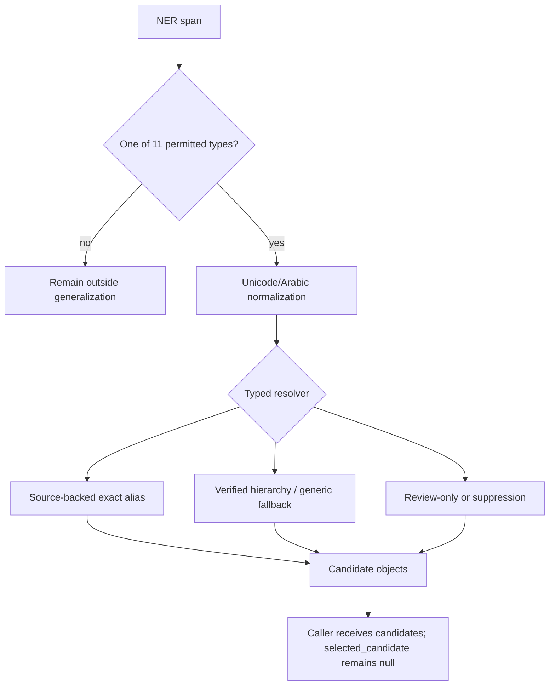
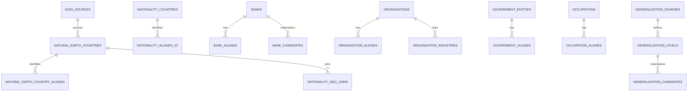

# Generalization architecture

The runtime is a read-only candidate API. It resolves an entity type and normalized alias, applies source/verification gates, then returns every permitted candidate. It does not rank, select, pseudonymize, call an LLM, or perform runtime fuzzy matching.

The complete actual SQLite inventory, columns, foreign keys, indexes, and DDL are in `reports/schema_after.md`, `reports/database_schema.sql`, and `reports/database_erd.mmd`.
